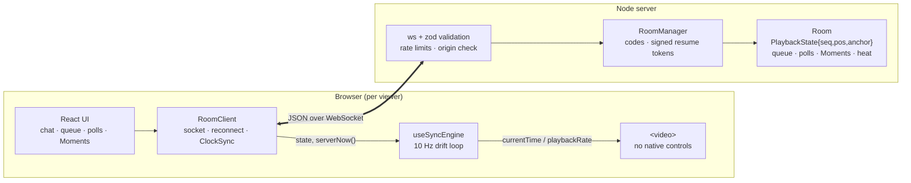
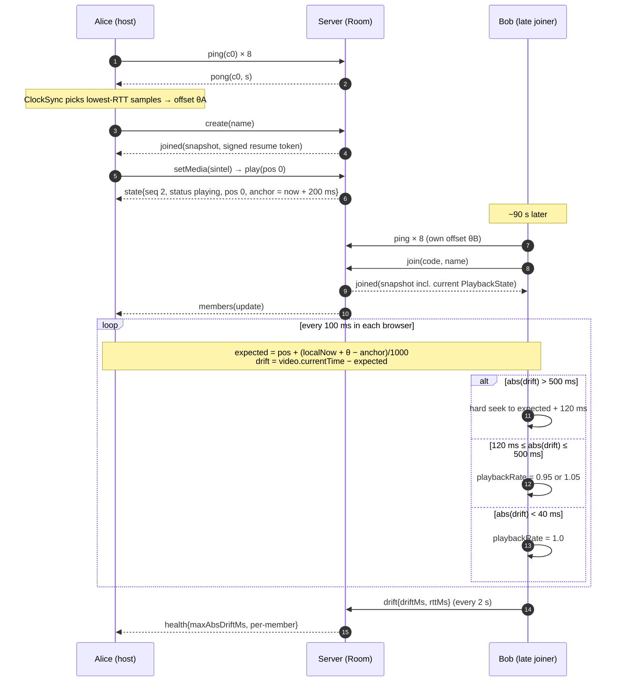

<div align="center">


# couchbeam

**Watch together. Frame for frame.**
Synchronized watch parties with a drift engine, time-locked chat and a crowd-sourced highlight reel.


-f2b441)


</div>

---

## What it is

Create a room, share a 6-character code or an invite link, and everyone's video plays, pauses and seeks together. A server-authoritative clock plus a client-side drift engine keeps every viewer within a fraction of a second of everyone else, even when someone's Wi-Fi hiccups, a tab is refreshed, or ten people hit **Pause** in the same instant.

### Beyond the brief — what makes Couchbeam different

| Feature | What it does |
| --- | --- |
| **Moments + Highlight Reel** | Anyone can bookmark the exact second they're watching. Bookmarks within 3 s of each other merge into votes for the same Moment. Hit **Highlight reel** and the room's top-voted Moments replay as short, synchronized clips in story order. |
| **Reaction Heatmap** | Emoji reactions are bucketed by *video time* and painted onto the seek bar as a heat strip, so you can see where the room gasped, laughed or screamed. |
| **Spoiler Shield** | Every chat message carries the sender's playhead. If someone is further into the movie than you, their message is blurred behind "written at 41:12, ahead of you" until you choose to reveal it. |
| **Scheduled starts** | Play/seek commands carry a server start time ~200 ms in the future, so a viewer 5 ms away and a viewer 80 ms away begin on the same frame. |
| **Buffering hold** | If one person stalls, the room pauses at the same spot and resumes together once they recover (capped at 8 s so nobody holds the room hostage). |
| **Live Sync Health HUD** | Click the pill on the player to see your drift, RTT, clock-sync error, hard-seek count and the room's worst drift. |

## Requirements checklist

| Requirement | Status |
| --- | --- |
| Create / join rooms via invite link or room code | Yes (`/r/ABC234`, 6-char codes, resume-on-refresh) |
| Synchronized play, pause, seek, buffer state | Yes (seq-numbered authoritative state + buffering hold) |
| Movie discovery: categories, filters, fuzzy search, recommendations | Yes (shared fuzzy engine, genre chips, sort, "More like this") |
| Emoji reactions, live chat, shared playlist, polls, host transfer | Yes (+ automatic host failover) |
| Automatic drift detection and correction | Yes (Cristian clock sync, 0.95x/1.05x nudges, hard seek > 500 ms) |
| Late joins, reconnections, concurrent actions | Yes (snapshot join, signed resume tokens, race guards) |
| >= 10 concurrent users per room | Tested at 12 and 50 |
| Propagation <= 250 ms at p95 (local network) | Measured, see [report](#latency--testing-report) |
| Drift <= 500 ms after correction | Measured, see [report](#latency--testing-report) |
| Documented latency measurements, test conditions, failure handling | This README + `scripts/benchmark-latency.ts` |

## Tech stack

| Layer | Choice | Why |
| --- | --- | --- |
| Client | React 18 + Vite 7 + TypeScript (strict) | Fast dev loop; the sync engine is a plain hook around a `<video>` element |
| Server | Node 20+/22, TypeScript, [`ws`](https://github.com/websockets/ws) | Raw WebSockets, no framing overhead ([ADR 0001](docs/adr/0001-raw-websockets-over-socketio.md)) |
| Protocol | zod discriminated union shared by client + server | One schema is both validator and type |
| State | In-memory rooms behind a transport-agnostic `Room` class | Hot, tiny, short-lived ([ADR 0003](docs/adr/0003-in-memory-rooms-first.md)) |
| Tests | Vitest (52 unit tests) + the benchmark's 14 scenario checks | Pure sync math and room logic are unit-tested without sockets |
| Packaging | npm workspaces, tsup, multi-stage Docker, GitHub Actions | |

> **Not in v0.1:** Redis Pub/Sub and PostgreSQL. They are listed in `.env.example` as `[RESERVED]` and the scale-out design is written up in [ADR 0003](docs/adr/0003-in-memory-rooms-first.md). v0.1 is a single node.

## Architecture



```
couchbeam/
├── shared/            protocol (zod), clock sync, drift policy, fuzzy search, catalog
│   ├── src/
│   └── test/          clock · drift · fuzzy unit tests
├── server/
│   ├── src/           config · logger · room (state machine) · manager · server (HTTP+WS)
│   └── test/          room logic: races, host election, buffering hold, Moments, reel…
├── client/
│   └── src/
│       ├── lib/       RoomClient (socket + clock), React store hooks
│       ├── hooks/     useSyncEngine  ← the drift engine
│       └── components/ Player · Discover · Panels · Landing · RoomView
├── scripts/           benchmark-latency.ts
├── docs/              ADRs + committed benchmark results
├── .github/           CI, CodeQL, Dependabot, issue template
├── Dockerfile · docker-compose.yml · .env.example · .gitignore
└── SECURITY.md · CHANGELOG.md · LICENSE
```

## Sync & drift correction strategy

### 1. Clock synchronisation (Cristian's algorithm, filtered)

Each ping exchange records `c0` (client send), `s` (server stamp) and `c3` (client receive):

```
rtt    = c3 − c0
offset = s − (c0 + c3) / 2          →  serverTime ≈ localTime + offset
error  ≤ rtt / 2                    (exact when up/down delays are symmetric)
```

Queueing delay only ever *adds* to RTT, so the **lowest-RTT sample in a sliding window of 12 is the most trustworthy**. `ClockSync` takes the median offset of samples whose RTT is within 1.5x of the minimum (+2 ms). A burst of 8 pings on connect (60 ms apart) gives a usable estimate in under half a second; after that one ping every 4 s tracks drift of the local clock.

### 2. One authoritative playhead

The server holds `PlaybackState { seq, status, pos, anchor }`. The position at server time `T` is

```
paused:   pos
playing:  pos + max(0, T − anchor) / 1000
```

Play, resume-from-hold and seek-while-playing set `anchor = now + PLAY_LEAD_MS` (default 200 ms). Clients convert `anchor` to their clock with the offset above and **start at that instant**, so network distance does not decide who starts first ([ADR 0002](docs/adr/0002-scheduled-start-and-server-authority.md)). Every transition bumps `seq`; a client never applies a state older than the one it holds.

### 3. Drift policy (runs every 100 ms in the browser)

```
expected = pos + (serverNow − anchor)/1000
drift    = video.currentTime − expected            (+ ahead, − behind)
```

| `abs(drift)` | Action |
| --- | --- |
| `> 500 ms` | **Hard seek** to `expected + 120 ms` (covers seek latency), rate back to 1.0 |
| `120 – 500 ms` | **Nudge rate**: `0.95` if ahead, `1.05` if behind (≈ 50 ms healed per second) |
| `< 40 ms` while nudging | Stop nudging (hysteresis, so the rate does not flap around the threshold) |
| paused / held / waiting for scheduled start | Sit exactly on the target frame (snap if off by > 80 ms) |

A 500 ms lag heals in ~10 s without a visible jump; a 120 ms lag in ~2.4 s. The policy is a pure function (`shared/src/drift.ts`) shared by the browser and the benchmark's virtual players, and it is unit-tested, including a convergence simulation.

**Error budget** for the steady state: clock error (≤ rtt/2) + the 120 ms engage threshold + seek stalls (transient, tens of ms) ≈ **100–250 ms in practice** against the 500 ms requirement.

### 4. Join and drift-correction flow



## Edge cases and failure handling

| Situation | What happens | Where verified |
| --- | --- | --- |
| **Two people press Play/Pause together** | Server arrival order decides. A Play within 400 ms of where the room already is, or a Pause when the room is already paused, changes nothing for anyone; the sender is simply re-synced, so the playhead never jumps. | `room.test.ts`, benchmark [5] |
| **Pause aimed at the previous movie** (host swapped titles mid-click) | Commands carry the last `seq` the sender saw; one older than the last media change is rejected as stale and the sender is resynced. | `room.test.ts` |
| **Concurrent seeks** | Last-writer-wins in server arrival order, identical for every client (all commands are absolute, so no vector clocks are needed). | `room.test.ts`, benchmark [5] (25 rounds × all clients firing at once) |
| **Late joiner** | Gets a full snapshot (state, members, chat, queue, polls, Moments, heat) and hard-seeks to the room position. | benchmark [8] |
| **Page refresh / Wi-Fi blip** | Seat held for `RECONNECT_GRACE_MS` (15 s). The client reconnects with exponential backoff + jitter and a signed token; same identity, host role and votes; missed state arrives in the snapshot. | `room.test.ts`, benchmark [7] |
| **Host disconnects for good** | After the grace period the oldest connected member becomes host; everyone is told. Explicit hand-over also works. | `room.test.ts`, benchmark [9] |
| **Everyone leaves** | Playback freezes where it was; the empty room is deleted after `ROOM_EMPTY_TTL_MS`. | `room.test.ts` |
| **Someone's stream stalls** | Debounced (400 ms) `buffering` report pauses the room at one position; it resumes together with a scheduled start. A stall can block for at most 8 s. The client ignores `waiting` events caused by its own corrective seeks. | `room.test.ts`, benchmark [6] |
| **Browser blocks autoplay** | The engine detects the rejected `play()` and shows a "Click to join the playback" overlay. | manual |
| **Duplicate `ended` reports** | Every client reports the end; the queue advances exactly once. | `room.test.ts` |
| **Flooding / hostile input** | Strict schema validation, 16 KiB frames, per-socket token bucket, per-feature limits, member/room/queue caps ([SECURITY.md](SECURITY.md)). | smoke-tested |
| **Dead TCP connections** | 10 s protocol ping/pong; a missed pong terminates the socket and starts the grace timer. | by design |

## Getting started

### Prerequisites
- Node.js **>= 20.12** (22 recommended) and npm 10+
- Optional: Docker 24+ for the container route
- Internet access in the browser (the sample catalog streams open-licensed clips from public hosts)

### Local development

```bash
git clone https://github.com/OWNER/couchbeam.git
cd couchbeam

cp .env.example .env          # all values are dummies; dev works as-is
npm install

npm run dev                   # server :8080 + Vite client :5173
```

Open <http://localhost:5173>, create a room, then open the invite link in a **second browser window (or a private window / another device)**, join with another name and pick a title in **Discover**.

> Testing from a phone or another machine on your LAN: run `npm run dev -w client -- --host`, and add that origin (for example `http://192.168.1.20:5173`) to `CORS_ORIGINS` in `.env`.

### Docker

```bash
cp .env.example .env
# set a real secret (required in production mode):
#   SESSION_SECRET=$(openssl rand -base64 48)
docker compose up --build     # http://localhost:8080
```

### Scripts

| Command | What it does |
| --- | --- |
| `npm run dev` | Server (watch) + client (HMR) |
| `npm run build` / `npm start` | Production build; serve with `CLIENT_DIST=client/dist` |
| `npm run typecheck` | Strict TypeScript across all packages and scripts |
| `npm test` | 52 unit tests (sync math, fuzzy search, room state machine) |
| `npm run bench` | Embedded-server latency / drift / race benchmark (see below) |
| `npm run bench:remote -- ws://HOST:8080/ws` | Same benchmark against a running server on your network |

Benchmark flags: `--clients 12 --commands 300 --interval 40 --drift-seconds 24 --warmup 12 --races 25 --delay 0 --jitter 0 --out benchmark-results.json`.

## Latency & testing report

### Method

`scripts/benchmark-latency.ts` starts the real server in-process (or targets a remote one) and connects **mock WebSocket clients that speak the real protocol**:

1. **Setup:** host creates a room; N-1 guests join concurrently.
2. **Clock sync:** every mock client runs with a random **±3 s local clock skew** and must recover server time using the same `ClockSync` class as the browser. Because the harness shares one process, true server time is known, so the offset error is measured exactly.
3. **Propagation:** one client at a time sends a command (≈ 75 % `seek`, 12–13 % each `pause` and `play`; every client takes a turn as sender). The sender stamps `t_send`; every *other* client stamps `t_recv` when the matching `state` (matched by command id) arrives. `propagation = t_recv − t_send` on one shared wall clock. Percentiles use nearest-rank.
4. **Drift:** each client owns a *virtual player* with a deliberately bad crystal (**±0.3 % playback-speed error**), random 40–160 ms seek stalls and a random **initial offset up to ±1.2 s**, driven by the **same `computeCorrection()`** as the browser at the same 100 ms cadence. Every 250 ms we sample each client's position against the authoritative position and the spread between clients. The first 12 s are warm-up and excluded from steady-state statistics.
5. **Scenarios:** simultaneous commands from every client (25 rounds), buffering hold, drop + reconnect with resume token, late joiner, host failover.

Exit code is non-zero if a requirement is missed, so CI can gate on it (the `CI` workflow runs it on every push).

### Test conditions and assumptions

- Machine: 2 vCPU Intel Xeon @ 2.1 GHz cloud VM, Node 22.22, Linux 6.18. Server **and all mock clients share these two cores**, so scheduling noise is included in the numbers.
- "Local network" is represented two ways: **loopback** (best case) and **simulated links** that add per-direction delay + jitter with strict FIFO ordering (TCP semantics). `10 ± 10 ms` each way approximates a busy Wi-Fi LAN (20–40 ms end to end); `60 ± 40 ms` each way approximates a poor long-distance link (120–200 ms end to end).
- Jitter is simulated; there is **no packet loss, reordering or bandwidth limit** (TCP hides most of these but not stalls).
- Virtual players model clock error and seek stalls; they do not decode video. Real browsers add decoder, buffering and rendering behaviour that this harness does not capture.

### Results

Command propagation, sender → every other client (ms):

| Profile | Clients | Deliveries | Lost | p50 | p90 | **p95** | p99 | max |
| --- | --- | --- | --- | --- | --- | --- | --- | --- |
| Loopback | 12 | 3,300 | 0 | 0.76 | 1.07 | **1.24** | 2.39 | 4.02 |
| Simulated LAN (10 ± 10 ms each way) | 12 | 1,650 | 0 | 30.96 | 36.64 | **37.92** | 39.64 | 41.24 |
| Simulated poor link (60 ± 40 ms each way) | 12 | 1,100 | 0 | 158.92 | 182.87 | **188.33** | 196.14 | 199.29 |
| Loopback, large room | 50 | 7,350 | 0 | 1.18 | 1.73 | **2.23** | 3.67 | 4.72 |

Requirement: p95 <= 250 ms. **Met in every profile**, including the deliberately poor link (p95 188 ms, about 60 ms of headroom).

Steady-state drift after correction (|drift| against authoritative time, after warm-up, ms):

| Profile | p50 | p95 | p99 | **max** | Worst spread between two clients | Time to get everyone < 500 ms from a ~1.2 s start |
| --- | --- | --- | --- | --- | --- | --- |
| Loopback, 12 | 45.8 | 108.0 | 111.6 | **112.4** | 156.2 | 0.3 s |
| Simulated LAN, 12 | 54.6 | 87.9 | 98.1 | **100.2** | 145.5 | 0.2 s |
| Simulated poor link, 12 | 36.4 | 90.9 | 99.1 | **101.3** | 143.4 | 0.3 s |
| Loopback, 50 | 44.6 | 104.0 | 112.6 | **115.0** | 176.9 | 0.3 s |

Requirement: drift <= 500 ms. **Met with about 4x margin.** The ceiling near 100–115 ms is the policy working as designed: drift is allowed to build to the 120 ms engage threshold before the rate nudge starts. Between *two* clients the gap can reach roughly twice that (one ahead, one behind), which is why the worst spread is 140–180 ms.

Clock synchronisation (clients started with up to ±3 s skew): offset error p50 0.4–1.5 ms, p95 0.7–1.5 ms on loopback/LAN and 8.6 ms on the poor link (bound is rtt/2).

Scenario checks (14 per run, all passed in all four runs): 12 and 50 concurrent members agree on membership; 25/25 simultaneous-command rounds ended with every client on the identical state and server state; sequence numbers never went backwards at any client; buffering hold reached every client (4–5 ms on loopback, 32 ms on the simulated LAN, 185 ms on the poor link); a dropped client rejoined with the **same seat**, received the seek it missed while offline, and was not duplicated (rejoin ≈ 355–740 ms including the 8-ping clock burst); a late joiner started 100 s behind and was within 500 ms in ≈ 100 ms; host failover elected the oldest remaining member and every client agreed, 1.6–2.3 s after the disconnect (the 1.5 s grace period plus the 1 s sweep tick).

Raw reports: [`docs/benchmarks/`](docs/benchmarks). Reproduce with `npm run bench`, or add `--delay 10 --jitter 10` / `--delay 60 --jitter 40` / `--clients 50`.

### Honest limits of this report

- These numbers prove the **protocol, server, clock sync and drift policy**. They do not prove how a specific browser's decoder behaves on a specific video. Do a manual two-device check (below) before claiming real-world results.
- Run `npm run bench:remote` from a second machine on your own Wi-Fi to get real LAN numbers for your hardware; the committed numbers are from a cloud VM.
- Single node. Rooms live in memory (see [ADR 0003](docs/adr/0003-in-memory-rooms-first.md)).

### Manual end-to-end check (2 minutes)

1. `npm run dev`; open two windows side by side; create a room in one, join from the invite link in the other.
2. Pick *For Bigger Fun* in **Discover**, press Play in window A. Both start together; open the HUD pill: drift should read well under ±150 ms.
3. Throttle window B in DevTools (Network → Slow 3G) and seek: window A should pause with "Waiting for B…" then resume together.
4. Refresh window B mid-playback: it rejoins as the same person and snaps back to the room position.
5. Mark a Moment, react with 🔥 a few times, send a chat message from the window that is further ahead (Spoiler Shield), then try **Highlight reel**.

## Security

Secrets stay out of git (`.env` ignored, dummy-only `.env.example`, gitleaks in CI); reconnect tokens are HMAC-signed and expiring; every inbound message is schema-validated and rate-limited; the served client ships with a strict CSP. Details and known limits in [SECURITY.md](SECURITY.md).

## Roadmap

- [ ] Redis directory + consistent-hash routing so rooms span nodes ([ADR 0003](docs/adr/0003-in-memory-rooms-first.md))
- [ ] Bring-your-own video URL / HLS source per room
- [ ] Collaborative subtitle offset editing (shared, synchronized)
- [ ] Voice room over a WebRTC mesh (signalling already fits the existing socket)
- [ ] Persistent watch history with Postgres
- [ ] Playwright end-to-end tests with a throttled second browser

## License

[MIT](LICENSE)
